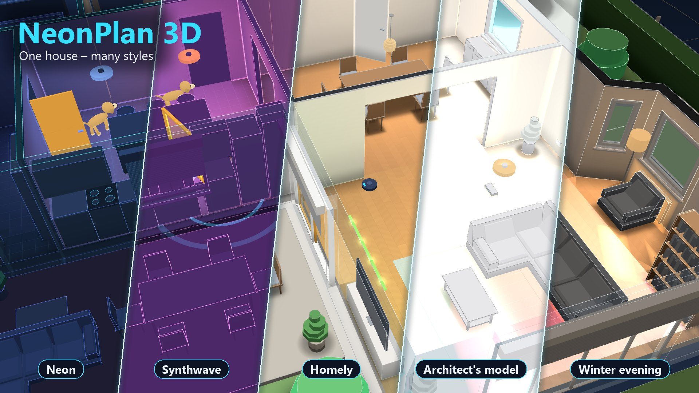

<div align="center">

# NeonPlan 3D – fork

**A 3D floor plan for Home Assistant: draw your home right inside Home Assistant and live in it as a glowing neon house, or in any style you like.**<br>
Lights glow in their colours, blinds move, doors open, cameras watch and energy flows through the walls.

[](https://my.home-assistant.io/redirect/marketplace_repository/?owner=wesleymaree&repository=neo3dclone&category=integration)

[](https://github.com/wesleymaree/neo3dclone/releases)
[](LICENSE)
[](https://www.home-assistant.io/)

[](#-features)

</div>

---

This is a fork of [NeonPlan 3D by Mastershort](https://github.com/Mastershort/neonplan3d) (MIT). It is based on version 4.0.3.

## 🔀 What is different in this fork

- **No account needed for the fun packs.** *Winter & Christmas* (fairy lights, snow, Christmas tree, Advent wreath, New Year's Eve firework), *Pets* (cats, dogs and rabbits walking through your house) and *Halloween* are always on. The "🎁 Free: winter and pets" sign-up popup no longer appears.
  Furniture that only comes from the shop's packs (such as a cat bed) is not included.
- **Your own 3D models as furniture.** Import an `.obj` file (with its `.mtl` for colours) or a `.step`/`.stp`/`.iges` CAD file. It appears in the furniture library and can be placed, moved, turned and resized like any other piece. [How to use it](#-your-own-3d-models)
- **Installs from this repository.** Updates come from the releases here, not from the original project.
- Paid Pro add-ons and shop furniture packs are not part of this repository, just as in the original.

## ✨ Features

- 🏘️ **Your whole property:** the house, the garage, the garden house, each on its own floor plan, all of them together in 3D.
- ✏️ **Draw it yourself:** walls, rooms, doors, windows, stairs, roofs and furniture. No CAD or Blender needed. You can also import a plan.
- 💡 **Live 3D and control:** lights glow in their real colours, blinds and doors move, and you tap a device to switch it.
- 🎨 **Every style:** Neon, Synthwave, Homely, Architect's model, Winter evening, or your own style.
- ⚡ **Energy:** solar fields, inverters, batteries and wallboxes with live values.
- 📱 **Dashboard card:** the whole house or single rooms, made for old wall tablets too.
- 🔒 **Local:** everything is stored in your Home Assistant.

The original project's [README](https://github.com/Mastershort/neonplan3d#readme) and [manual](https://mastershort.de/en/neonplan3d/manual/?lang=en) describe every feature in detail.

## 📦 Installation

Requires Home Assistant 2025.1 or newer.

### Marketplace (Home Assistant 2026.11 and newer)

1. Click the **Open in Marketplace** button at the top, or open **Settings → Marketplace**, choose to add a repository from a GitHub link and paste `https://github.com/wesleymaree/neo3dclone`.
2. Install **NeonPlan 3D** and restart Home Assistant.

### HACS (older Home Assistant)

1. **HACS → ⋮ → Custom repositories**: add `https://github.com/wesleymaree/neo3dclone` with the type **Integration**.
2. Search for **NeonPlan 3D (fork)**, download it and restart Home Assistant.

### Manual

Copy `custom_components/neonplan3d` into `/config/custom_components/` on your Home Assistant and restart.

### Setting it up

1. **Settings → Devices & services → Add integration → NeonPlan 3D**, or use this button: [](https://my.home-assistant.io/redirect/config_flow_start/?domain=neonplan3d)
2. Open **NeonPlan 3D** in the sidebar, switch to **Editor** and draw your first floor, or import a plan.
3. To set up the fun packs, go to the editor's **⚙ Settings → Fun packs**. There you can add pets and switch the winter effects on or off.
4. To put it on a dashboard, use **Add card** and search for "NeonPlan". For a single room, select it in the editor and use **🖥 Card for this room**.

> The integration's domain is `neonplan3d`, the same as the original. Remove the original NeonPlan 3D before you install this fork.

## 📦 Your own 3D models

1. Open **Editor → Furniture**. At the bottom of the library, under **Your own 3D models**, click **Import 3D model**.
2. Choose the file:
   - **OBJ:** select the `.obj` and its `.mtl` together to keep the colours. Without the `.mtl` the model takes the furniture colour of the current look.
   - **STEP / STP / IGES:** CAD files are converted in the browser with [OpenCascade](https://dev.opencascade.org/) (about 8 MB, loaded only while you import).
3. Check the name, the category (where it appears in the library), the unit of the file and whether the Z axis points up. The size it will get is shown underneath.
4. Click **Add to the library**. The model now appears in its category and is placed like any other piece of furniture.

- Models with more than 50,000 triangles are simplified automatically.
- The models are stored in Home Assistant (`.storage/neonplan3d.models`) and show on every dashboard.
- To delete a model, use ✕ next to it in the same box. Furniture already placed with it becomes a plain box.

## 🧩 Dashboard card

All options can be set in the card's visual editor. The most used ones in YAML:

```yaml
type: custom:neonplan3d-card
template: kitchen_fire  # a card template made in the editor (then only it counts)
plan: pab12cd34ef       # another floor plan (id under ⚙ → Floor plans); site = the whole property
rooms: [room_ab12cd34]  # only these rooms; rooms_lock: false lets the viewer leave them
floor: floor_ab12cd34   # a single floor; room: opens a room
height: 420             # height in pixels, or fill: true for the whole screen
quality: auto           # auto | low | high – "auto" picks the tablet level on weak devices
theme: neon             # neon | blueprint | day, with accent: "#00e5ff"
voice: false            # 🎙️ microphone button; voice_area: the room this tablet hangs in
idle_return: 0          # kiosk: seconds without a touch until the start view returns
night: "off"            # kiosk: dim at night – off | sun | "22:00-06:00"
```

## 🔒 Privacy

Plans, pictures and packs are stored in Home Assistant's `.storage`. The integration only contacts the original shop (mastershort.de) if you enter a licence key under **Extensions**. Anonymous usage and error reports are off unless you switch them on under **⚙ Settings → 🛟 Help improve**.

## 🛠️ Development

```bash
cd frontend
npm install
npm test            # unit tests
npm run typecheck
npm run build       # writes the bundles to custom_components/neonplan3d/frontend (committed) and checks the size budgets
npm run screenshot  # renders preview/index.html (invented demo data) with a local Chrome or Edge
```

- Run `npm run build` before every commit. The built bundles are committed, and CI fails when they are out of date.
- To ship an update, raise `version` in `custom_components/neonplan3d/manifest.json`, push, and publish a GitHub release tagged `v<version>`. The release workflow checks that the tag matches.
- To deploy to a test instance, create `deploy.local.json` in the repository root with `{"target": "<config>/custom_components/neonplan3d"}` and run `npm run deploy` in `frontend/`.

## 🐞 Bugs and ideas

[Open an issue](https://github.com/wesleymaree/neo3dclone/issues) in this repository. Please don't report problems with this fork to the original project.

## 📄 Licence and credits

MIT – see [LICENSE](LICENSE). NeonPlan 3D was created by [Mastershort](https://github.com/Mastershort/neonplan3d); "NeonPlan 3D" is the name of the original project. If you like it, consider supporting the original author: https://mastershort.de/en/neonplan3d/?lang=en
